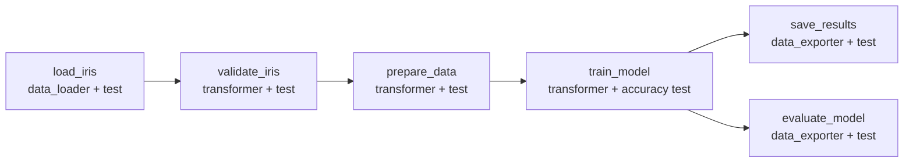
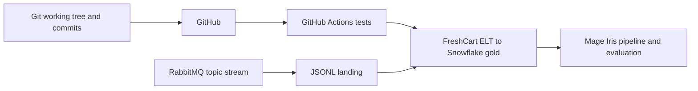

# From Git to Gold

**Name / roll number:** [complete]  
**GitHub repository:** [paste URL after creating the remote]  
**Environment:** Python 3.12; Snowflake and RabbitMQ account details: [complete]

> This is a working report, not evidence of live service runs. Replace every bracketed item with your own run output and explanations. The course starter notebooks were not supplied in the workspace. The local fixture is tuned to the assignment's baseline totals, but verify its field mappings, customer history, and loyalty policy against the class materials before using it as Snowflake evidence.

## A. Git and CI/CD

### A1. Repository and history

Repository layout is provided in the project root. Paste `git log --oneline` here after making at least five meaningful commits:

```text
[paste output]
```

Paste the GitHub Actions links or screenshots for one passing run and one intentionally failing run (made by temporarily changing the split size, then fixing it):

```text
[green run evidence]
[red run evidence and fixing commit]
```

### A2. Where commands act

| Command | Where the change happens | What exactly happens? |
|---|---|---|
| `git init` | Local working directory | [Explain in your own words.] |
| `git add train.py` | Staging area / index | [Explain in your own words.] |
| `git commit -m "msg"` | Local Git repository | [Explain in your own words.] |
| `git remote add origin URL` | Local repository configuration | [Explain in your own words.] |
| `git push -u origin main` | Remote repository | [Explain in your own words.] |
| `git pull origin main` | Local repository and working tree | [Explain fetch plus integration in your own words.] |

**Can a teammate see code after `git commit`?** [Answer in your own words; distinguish a local commit from a push.]

### A3. CI test

The test in `tests/test_prepare_data.py` checks the required 120/30 split. Local result: **7 tests passed**. GitHub Actions result: **[paste link/screenshot]**.

## B. FreshCart ELT

### B1. Baseline

| Check | Course expected | Your Snowflake output |
|---|---:|---:|
| Bronze raw rows after one load | 8 | [fill] |
| Silver clean rows | 6 | [fill] |
| Quarantine rows | 2 | [fill] |
| Deduplicated orders | 4 | [fill] |
| Gold orders / revenue / points | 4 / INR 7,785 / 126 | [fill] |
| Rejected share | 25% | [fill] |

Attach screenshots of each query result. The notebook's local fixture matches the row counts and revenue, but its tier-event and point assumptions must be reconciled with the course notebook before treating loyalty totals as course results.

### B2. Record trace

Use the ORD-1003 result cells in `elt/freshcart_elt.ipynb`. In your own words, record the two JSON shapes, normalization aliases, winning dedup row, and arithmetic:

- Bronze website record: [paste observed JSON; note its field names and missing amount]
- Bronze mobile record: [paste observed JSON]
- `silver.orders_checked` expressions: [name the `COALESCE`/casts that align their columns]
- Dedup winner and `ROW_NUMBER()` ordering: [explain using the observed timestamps]
- Gold amount and points arithmetic: [use the actual tier and policy from the course notebook]
- ORD-1005 versus ORD-1001: [name the SCD2 table and effective-date join; explain Priya's tier on each order]

### B3. Currency validation

`SQL_10_ORDERS_CLEAN.sql` includes the `unsupported_currency` reason. Record the observed ORD-1006 array before/after the change and explain why the gold total and quarantine row count do or do not change:

- Before: [paste result]
- After: [paste result]
- Explanation: [write in your own words; identify the quarantine `MERGE` key]

### B4. SCD2 and idempotency

Before adding the CRM event, write and save your predictions. Do not fill the prediction column after running the pipeline.

| Quantity | Your prediction before run | Actual after run |
|---|---|---|
| CUST-02 rows in `dim.customers_scd2` | [write before run] | [fill] |
| Tier used for ORD-1002 | [write before run] | [fill] |
| ORD-1002 loyalty points | [write before run] | [fill] |
| Total gold loyalty points | [write before run] | [fill] |
| Gold rows whose `published_at` changed | [write before run] | [fill] |

Explain `row_hash`, the `MERGE` match/update behavior, and why bronze receives another batch on each fresh landing-file load: [4–6 sentences in your own words].

### B5. Data quality

The sixth check is `gold_orders_not_future_dated`. Make one temporary future-dated mock order, rerun and paste the `PROBLEM` output, then remove the mock order and rerun. Evidence: [paste output/screenshot].

Explain why ELT fits FreshCart and identify one lecture situation where ETL would be preferable: [3–4 sentences in your own words].

## C. Mage Iris pipeline

### C1. Graph



Paste `mage run iris_project iris_classifier --test` output here: [paste]. Mage UI graph screenshot: [attach].

### C2. Test gate

Run each depth in Mage, delete `iris_predictions.csv` before each run, and record the actual values. A failed train test should prevent the save exporter from running.

| `max_depth` | Test accuracy | Accuracy test passed? | CSV created? |
|---:|---:|---|---|
| 1 | 0.6667 (local preview) | No | No after a clean start |
| 2 | 0.9333 (local preview) | Yes | Yes |
| 3 | 0.9667 (local preview) | Yes | Yes |
| 4 | 0.9333 (local preview) | Yes | Yes |
| 5 | 0.9333 (local preview) | Yes | Yes |

These are local runs of the same block code; confirm and capture the five runs from Mage using `--runtime-vars` for submission.

Explain how a failing `@test` gates downstream exporters and why that is safer than checking a saved artifact afterward: [write in your own words].

### C3. Evaluation branch

The local Python 3.12 run at depth 3 produced 0.9667 accuracy and this confusion matrix:

```text
[[10  0  0]
 [ 0  9  1]
 [ 0  0 10]]
```

Paste the Mage run's confusion matrix, metrics table, and UI graph screenshot here: [attach].

### C4. Added block

`validate_iris` checks for missing values and exactly three classes, with its own test. CI local result: [paste `pytest` output]; GitHub Actions link: [paste].

## D. RabbitMQ stream

### D1. Routing prediction

Write and save this table **before** running the broker. Use RabbitMQ topic semantics: `*` consumes exactly one word and `#` consumes zero or more words.

| Routing key | Your predicted receiving queues |
|---|---|
| `bangalore.koramangala.food` | [predict] |
| `bangalore.indiranagar.ride` | [predict] |
| `bangalore.whitefield.ride` | [predict] |
| `chennai.tnagar.food` | [predict] |
| `chennai.whitefield.ride` | [predict] |
| `bangalore.koramangala` | [predict; explain the two-word key] |

### D2–D3. Run and acknowledgements

Run the dispatcher and at least three drivers for two minutes. Paste terminal output proving one D1 route and one discarded malformed message: [attach].

In your own words, explain what RabbitMQ does with an unacknowledged message after a driver disconnects, and why `requeue=True` can create a poison-message loop: [answer].

## E. Integration and reflection



Reflection (about half a page): describe one thing that actually broke in your run, how you located the cause, and how you fixed it. [Write this from your own experience.]

### Bonus: stream into the lakehouse

Run the order publisher/consumer for one minute. Paste output showing the same gold row count and total before/after replay: [attach]. Confirm whether only raw bronze increased: [explain from observed results].

## Submission evidence checklist

- [ ] Create GitHub repo `freshcart-pipelines`, push `main`, and paste its URL above.
- [ ] Make at least five meaningful commits and paste `git log --oneline`.
- [ ] Capture green and red GitHub Actions runs; restore the passing test afterward.
- [ ] Run the notebook with your Snowflake account and capture query outputs/screenshots.
- [ ] Run Mage CLI/UI; capture the block graph and results for depths 1–5.
- [ ] Run RabbitMQ with three drivers for two minutes and capture routing/ACK/NACK output.
- [ ] Complete your own pre-run B4 and D1 predictions and reflection before exporting the report PDF.
- [ ] Export a PDF named `RollNo_Name_Pipelines.pdf` and keep it within the page limit.